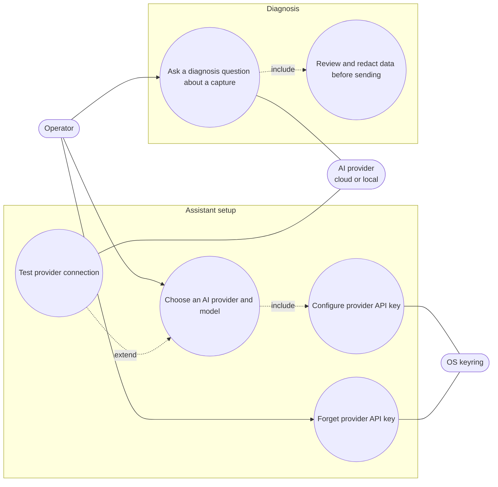

# AI assistant — use cases (#83)

Refines [ADR-0007](../../../decisions/ADR-0007-ai-agent-read-only-mcp.md): the assistant is
read-only and has no path to transmission.

- Transport: TLS (https) is mandatory for every endpoint except loopback; cleartext http
  is accepted only to this PC.
- **Choose an AI provider and model**: flat dropdown of Anthropic, OpenAI, Mistral, Google and
  Local (Ollama / OpenAI-compatible). Default model per provider (Anthropic: latest Claude).
  Provider, model and endpoint (non-secret) persist in QSettings; the key never does.
- **Configure provider API key** (cloud only): guided panel shows where to create the key
  (link), the expected format and a format check; the key goes **only** to the OS keyring
  and is shown masked. Local shows an endpoint URL field instead — no key.
- **Forget provider API key**: deletes the keyring entry.
- **Test provider connection**: one minimal request, for cloud and local alike; result shown
  as OK / error (the error text never contains the key).
- **Ask a diagnosis question**: available only when the provider is ready **and** a capture
  exists (progressive disclosure).
- **Review and redact data before sending**: the exact payload is previewed and **every send
  is confirmed**, local included. Redaction is on by default: module addresses are
  pseudonymised consistently within a request (same address → same `M1`, `M2`…), timestamps
  become relative, payloads busscope cannot decode (which may carry serial numbers) are masked. A "Local"
  endpoint that is not a loopback address is treated as cloud (warning shown).
- Out of scope: the AI never transmits on a bus (no tool access, text answers only).
