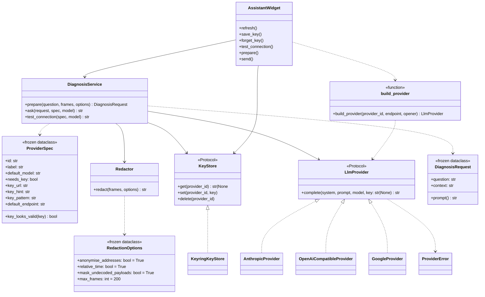

# AI assistant — classes (#83)

Each adapter is built with its `base_url` and a 60 s timeout. `OpenAiCompatibleProvider` serves OpenAI, Mistral and Local (Ollama `/v1`) — same wire format,
different base URL. Adapters use the stdlib HTTP client (`urllib`), no vendor SDK.

Providers are a flat, immutable registry of `ProviderSpec` — deliberately **not** nodes of the
#77 inheritable tree (no inheritance need; YAGNI).
