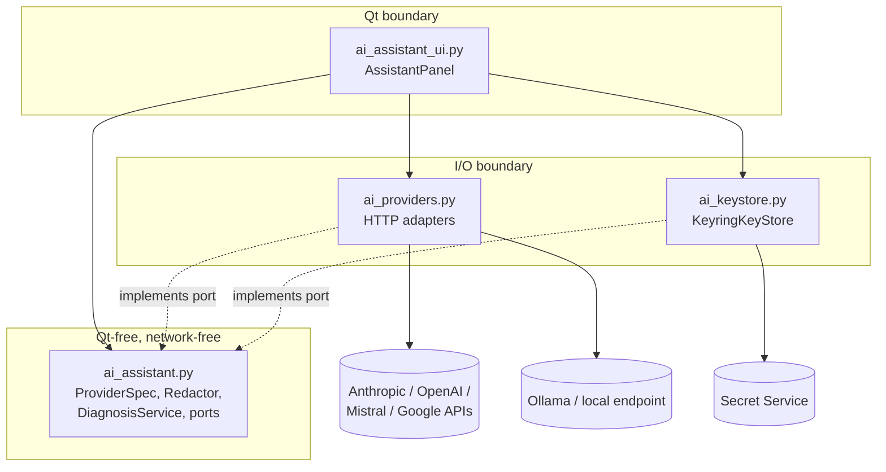

# AI assistant — components (#83)

Dependency rule: `ai_assistant.py` imports nothing from PySide6, `keyring` or `urllib`.
Non-secret choices (provider, model, endpoint) persist via the existing QSettings adapter.
The capture frames reach the panel via the existing session model; the assistant has no
access to transmission.
