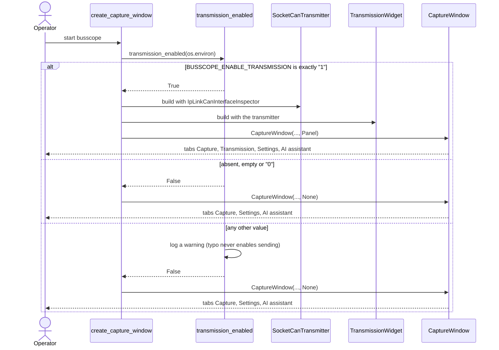

# Sequence diagram — manual transmission — startup kill switch

> **Feature**: issue #95 — runtime (environment variable) kill switch for the transmission tab
> **Decision**: [ADR-0009](../../../decisions/ADR-0009-transmission-kill-switch.md)

## Context

Transmission stays disabled until it is explicitly enabled (AGENTS.md, Safety). The composition
root reads one environment variable at startup. When the switch is off, no transmitter and no
Transmission tab exist in the process at all: there is nothing to unlock from the UI.

## Diagram

## Notes

- `transmission_enabled` lives in the framework-independent `transmission` module and takes a
  mapping, so the decision is tested without Qt or a real environment.
- The switch is read once, at startup; changing it needs a restart.
- The existing safety gates (checkbox, confirmation, listen-only refusal) still apply when on.
