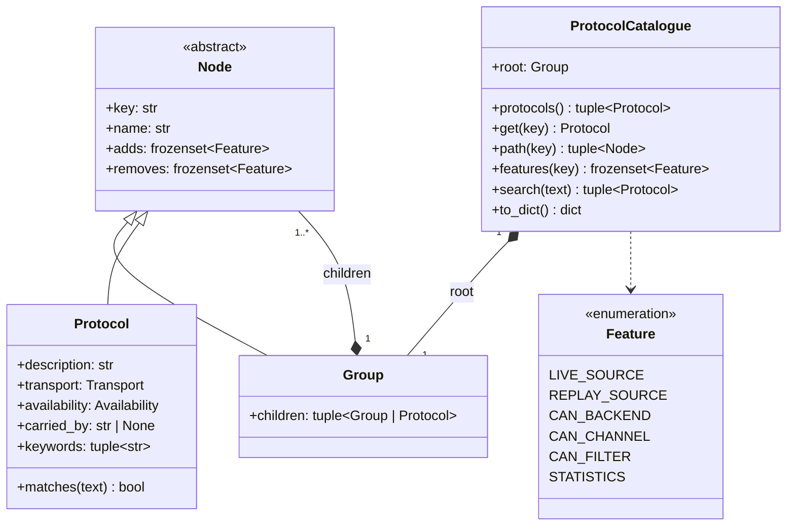

# Minimal contextual UI — class diagram (inheritable domain tree)

Replaces the fixed `Family → SubFamily → Protocol` levels of #72 with a composite tree:
`Group` nodes of any depth, `Protocol` leaves. `Node` is the `Group | Protocol` union.
A node declares the **features** it owns (settings and actions); a descendant inherits them
by walking up the tree and only adds or removes. A protocol is a leaf node. Everything stays
Qt-free and exported as JSON for the future React UI (ADR-0006).

## Resolution rule

`features(key)` folds the path root → … → leaf: `resolved = (resolved ∪ node.adds) − node.removes`.
Features are therefore declared once, at the highest node that owns them:

| Node | adds | Why |
| --- | --- | --- |
| root `all` | `LIVE_SOURCE`, `REPLAY_SOURCE`, `STATISTICS` | any shipped decoder can listen live, replay a CSV and count |
| `fieldbus/can` | `CAN_BACKEND`, `CAN_CHANNEL`, `CAN_FILTER` | every CAN protocol shares the CAN adapter settings |

`PLANNED` protocols resolve to no feature: they stay visible in the catalogue but unselectable.
The root group is not shown in the picker; its children are the top-level domains.

## Invariants (kept from #72)

- unique keys across the whole tree (groups and protocols share one namespace);
- a protocol is a leaf, a group has ≥ 1 child;
- the `carried_by` chain references known protocols and never cycles;
- `removes` only names a feature an ancestor added (no silent no-op).

JSON export: `{"root": node}`; a group is `{key, name, adds, removes, children}`, a protocol
`{key, name, adds, removes, description, transport, availability, carriedBy, keywords}`.
