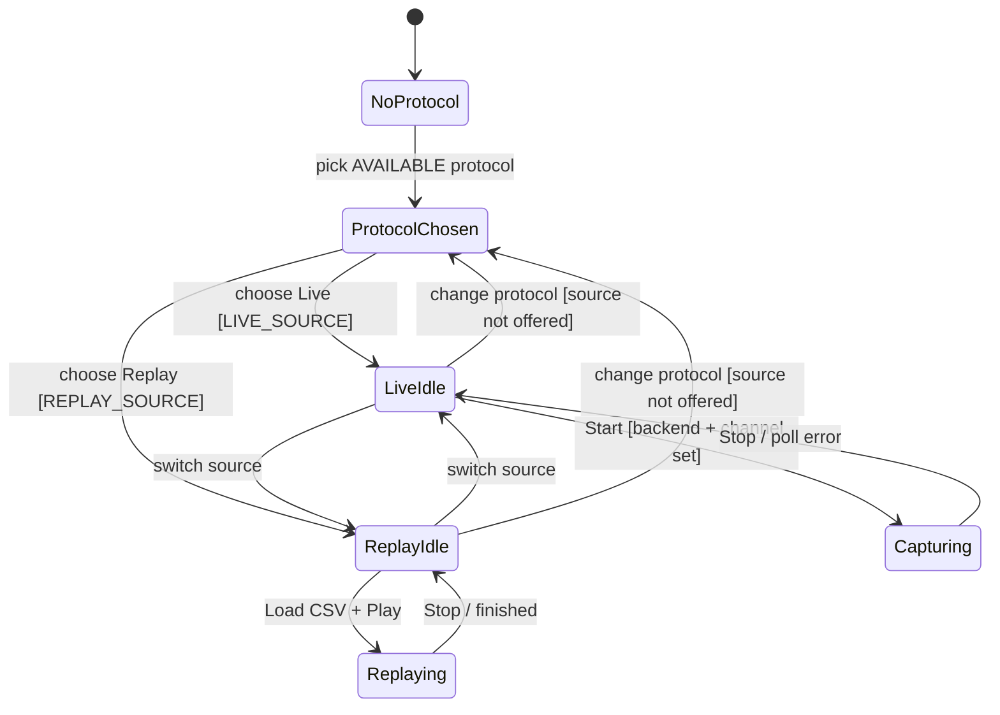

# Minimal contextual UI — progressive disclosure state diagram

A control is shown only when the chosen protocol resolves the matching `Feature`
**and** the current state allows it. Listen-only stays the only capture mode.

Notes:

- The protocol picker is locked while a source feeds the view (`Capturing`, `Replaying`).
- There is no way back to `NoProtocol`: a protocol, once picked, can only be changed.
- Changing protocol keeps the current source when the new protocol offers it.
- A protocol with a single source skips the choice: `ProtocolChosen` goes straight to it.
- `Accept unverified silence` lives inside `LiveIdle` and only when backend = slcan.
