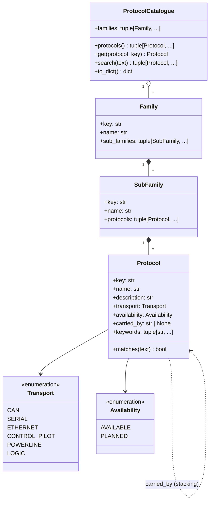

# Protocol catalogue — class diagram

Qt-free registry (`src/busscope/protocol_catalogue.py`), immutable data, reusable by the future
React UI (ADR-0006) through a plain dict/JSON export.

Invariants: keys unique across the catalogue; `carried_by` names an existing protocol; no
cycles; `search` matches name, description and keywords case-insensitively.
