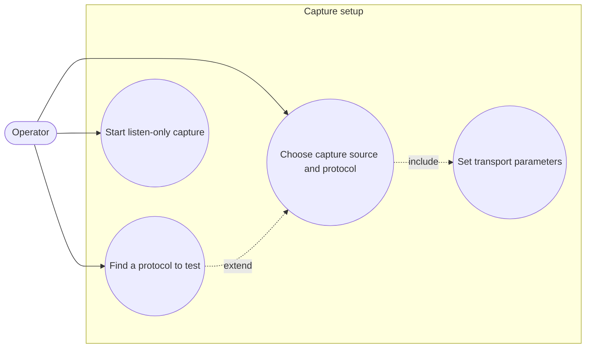

# Protocol catalogue — use cases

- **Find a protocol to test**: browse families / sub-families or type a search; planned
  protocols are shown greyed with their status.
- **Choose capture source and protocol**: only *available* protocols can be selected.
- **Set transport parameters**: fields depend on the protocol's transport (CAN → backend,
  channel, bitrate, ID filter).
- **Start listen-only capture**: unchanged; no transmit path is added.
