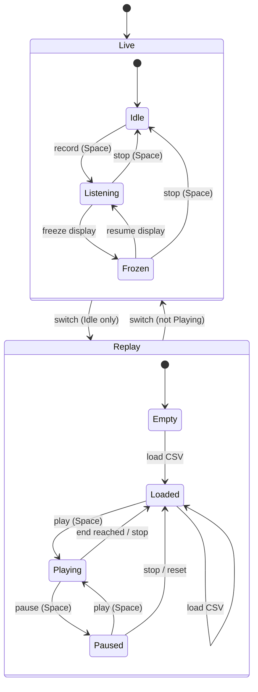

# State diagram — context-aware capture toolbar

> **Feature**: issue #69 — replace the 11 text buttons of the capture tab with a mode-aware
> icon toolbar (≤ 6 visible controls per mode).

## Context

The toolbar has two modes selected by a segmented switch: **Live** (SocketCAN / slcan capture)
and **Replay** (exported CSV). Each mode shows one primary toggle; actions that do not apply
to the current state are hidden, not greyed. The listen-only lock is visible in every state.
Switching mode is blocked while a capture is listening or a replay is playing, so the two
sources never feed the frame view at once.

The state machine is UI-framework neutral so the future React UI (ADR-0006) can reuse it.

## Diagram

## Visible controls per state

| State | Visible controls (left → right) | Count |
|---|---|---|
| Live · Idle | mode switch, ⏺ record, 🗑 clear, 💾 export, ⋯ overflow | 5 |
| Live · Listening / Frozen | mode switch, ⏹ stop, ❄ freeze ⇄ ▶ resume, 🗑 clear, 💾 export, ⋯ | 6 |
| Replay · Empty | mode switch, 📂 load, ⋯ | 3 |
| Replay · Loaded | mode switch, ▶ play, 📂 load, 💾 export, ⋯ | 5 |
| Replay · Playing / Paused | mode switch, ⏸ pause ⇄ ▶ play, ⏹ stop, 💾 export, ⋯ | 5 |

Always visible, outside the count: status pill (`Idle`, `Listening`, `Frozen`, `No capture`, `Loaded`, `Playing`, `Paused`) and the
🔒 listen-only lock. Overflow menu: refresh statistics (when temporal statistics are on), reset
replay (Replay mode). Load CSV stays a toolbar icon because it is the entry point of Replay.
Backend / channel / filter fields stay as today, shown in Live mode only (filter in both).
